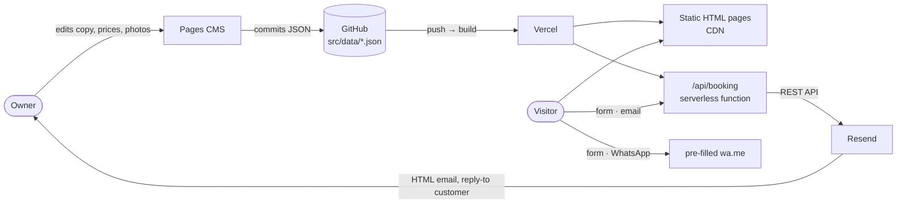

<div align="center">


### Marketing and booking website for a cryotherapy equipment rental business

**[srf-cryorecovery.com](https://www.srf-cryorecovery.com)**

[](https://astro.build)
[](https://www.srf-cryorecovery.com)
[](https://resend.com)
[](https://pagescms.org)


</div>

---

## About

**SRF Santarém** rents cold and compression therapy devices for recovery after orthopedic surgery or sports injuries, with delivery in Santarém and shipping across Portugal.

I designed and built the site end to end for this real client: design, front end, booking form, transactional email, deployment, and an editing tool that lets the owner update copy, prices and photos **without touching code**.

| | |
|---|---|
| **Type** | Client project, live in production |
| **Role** | Sole developer (design, front end, back end, deployment) |
| **Site language** | Portuguese (pt-PT) |
| **Pages** | Home · Benefits · Equipment · Pricing & Delivery · Contact · Terms · Privacy · custom 404 |

## Highlights

### 1. The client owns their content
All copy, pricing, carousel photos and contact details live in JSON files (`src/data/`). [Pages CMS](https://pagescms.org) exposes them through a simple editing UI, configured in [`.pages.yml`](.pages.yml) with Portuguese labels and constraints (e.g. exactly 2 plan cards, exactly 3 videos).

Every edit the client makes becomes a Git commit (`Update src/data/pricing.json (via Pages CMS)`), which triggers a redeploy. No database, no admin panel to maintain, and a full, reversible history.

Rates are entered **once** (`rates`) and reused everywhere: the pricing page, the animated counters, and the deposit mention on the home page.

### 2. Static by default, a single server route
Astro generates the site as static HTML. Only one route runs on demand on Vercel: [`/api/booking`](src/pages/api/booking.js) (`prerender = false`), which emails rental requests through the Resend API.

Result: pages served from the CDN, near-zero hosting cost, minimal attack surface.

### 3. English codebase, Portuguese URLs
The code is written in English (files, components, JSON keys, identifiers) while visitors get Portuguese URLs (`/precos`, `/contactos`, `/privacidade`…). A small Astro integration (under 20 lines) in [`astro.config.mjs`](astro.config.mjs) maps each public route to a view in `src/views/` with `injectRoute`. One route per view keeps bundles per page, so the map's CSS only ships on `/contactos`.

The CMS follows the same split: field names are English identifiers, labels shown to the client stay in Portuguese.

### 4. A booking form built for the local market
In Portugal, many customers prefer WhatsApp over email. The form therefore offers **two ways to send** from the same fields:

- **WhatsApp**: the message is assembled client-side and opens a pre-filled `wa.me` link, never touching the server.
- **Email**: `POST /api/booking`, which sends an HTML email to the owner with `reply_to` set to the customer's address.

On the server, the endpoint is treated as a trust boundary:

- inputs are sanitized and truncated (200 characters, 4000 for the message);
- required fields and email format are validated;
- every value injected into the email is HTML-escaped;
- **honeypot** spam trap: a hidden field only bots fill in, answered with a fake "ok" so they don't learn they were caught;
- environment variables are typed and marked secret via `astro:env`; if they are missing, the site still boots and fails gracefully;
- user-facing errors always point to WhatsApp or phone, so a lead is never lost.

### 5. Privacy by design (GDPR)
The form can collect health data (type and date of surgery), which the GDPR treats as a special category. The site is built around that:

- **explicit consent** checkbox on the form, linked to a dedicated [privacy policy](src/views/Privacy.astro), plus [terms and conditions](src/views/Terms.astro);
- **no third-party tracking**: the contact page uses an [OpenStreetMap map](src/components/LocationMap.astro) (Leaflet) rather than a Google Maps embed, and the Inter Tight font is self-hosted via Fontsource instead of Google Fonts, so a visit sends no data to Google; audience stats come from Vercel Web Analytics, which is cookieless and does not identify visitors, so no cookie banner is needed;
- the legal identity (legal name, tax ID, VAT regime) is editable in the CMS; until it is filled in, the legal pages show a visible `[… — a preencher]` placeholder instead of silently publishing incomplete information;
- the footer links to the *Livro de Reclamações*, the official complaints book required for Portuguese businesses.

### 6. Little code, no unnecessary dependencies
| | |
|---|---|
| Dependencies | **5** (`astro`, `@astrojs/vercel`, `@vercel/analytics`, `leaflet`, a Fontsource font) |
| Client JavaScript | **~80 lines** of vanilla JS, plus Leaflet loaded on the contact page only |
| CSS | One stylesheet, CSS custom properties, `clamp()` for fluid typography |
| Astro components | 6, small and single-purpose |

Animations (line-by-line title reveals, scroll-triggered fade-ins, price counters, a carousel with crossfade) rely on `IntersectionObserver`, `requestAnimationFrame`, CSS scroll snapping and the Web Animations API. Leaflet and its CSS are imported dynamically only when the map gets close to the viewport.

### 7. Accessibility and respect for the user
- `prefers-reduced-motion` honored throughout: counters disabled, hero video not autoplayed, animations turned off;
- mobile menu with `aria-expanded`, current page marked with `aria-current`;
- form feedback and carousel title announced to screen readers (`aria-live`);
- `autocomplete` attributes, native input types (`tel`, `email`, `date`), lazy-loaded images, map exposed as `role="img"` with the address as its label;
- background videos muted, `playsinline`, with a `poster` image.

## Architecture



## Tech stack

| Layer | Choice | Why |
|---|---|---|
| Framework | [Astro 5](https://astro.build) | Static HTML, zero JS shipped by default, simple components |
| Hosting | [Vercel](https://vercel.com) + `@astrojs/vercel` | CDN, per-branch previews, a serverless function for a single route |
| Email | [Resend](https://resend.com) (REST API, no SDK) | Verified domain (SPF/DKIM via Cloudflare); a plain `fetch` is enough |
| Content | [Pages CMS](https://pagescms.org) | Visual editing of JSON files versioned in Git |
| Map | [Leaflet](https://leafletjs.com) + OpenStreetMap | No tracking cookies, unlike an embedded Google map |
| Analytics | [Vercel Web Analytics](https://vercel.com/analytics) | Cookieless, aggregate stats only |
| Font | Inter Tight via [Fontsource](https://fontsource.org) | Self-hosted: no extra domain to connect to, no request to Google |
| Front end | HTML, CSS, vanilla JavaScript | No framework on the client |

## Project structure

```
.
├── .pages.yml              # CMS schema: what the client can edit
├── astro.config.mjs        # Vercel adapter, Portuguese routes, typed env vars
├── public/
│   ├── script.js           # Menu, animations, carousel, form
│   ├── style.css           # All styling
│   ├── img/                # CMS-managed media
│   └── video/              # Background videos + posters
└── src/
    ├── data/               # Editable content (JSON): site, home, pricing…
    ├── components/         # Carousel, Packages, Highlight, Lines, PageHero, LocationMap
    ├── layouts/Layout.astro
    ├── lib.js              # WhatsApp/tel: links, legal-info placeholder helper
    ├── views/              # Benefits, Equipment, Pricing, Contact, Terms, Privacy
    └── pages/
        ├── index.astro     # Home
        ├── 404.astro       # Custom not-found page
        └── api/booking.js  # The only server route: sends rental requests
```

## Getting started

Requires Node.js 22 or later.

```bash
npm install
```

```bash
cp .env.example .env
```

```bash
npm run dev
```

The site runs at `http://localhost:4321`. The Resend variables are optional locally: without them everything works except email sending, which returns a clean error.

| Script | Purpose |
|---|---|
| `npm run dev` | Development server |
| `npm run build` | Production build |
| `npm run preview` | Preview the build |

### Environment variables

| Variable | Description |
|---|---|
| `RESEND_API_KEY` | Resend API key |
| `EMAIL_FROM` | Sender, on a domain verified in Resend |
| `EMAIL_TO` | Recipient of rental requests |

In production they are set in Vercel (*Project Settings → Environment Variables*).

## Deployment

Every push to `main` (including CMS commits) triggers a Vercel build. Every branch and pull request gets its own preview URL.

---

<div align="center">

Designed and built by **[Rui Gaspar](https://github.com/justRunz)**

</div>
